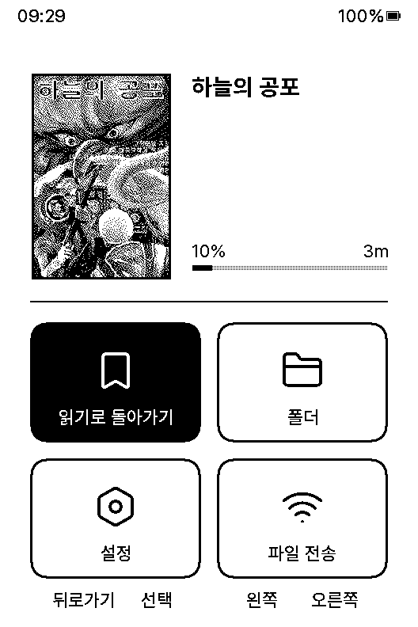

# CrossPoint Reader KO — 타일 에디션

[CrossPoint Reader KO](https://github.com/crosspoint-reader-ko/crosspoint-reader-ko)(한국어판 CrossPoint 펌웨어)에
순정 펌웨어 느낌의 **타일 홈 화면**과 **내장 명조 글꼴**을 얹은 개인 포크입니다.
Xteink X3에 맞춰 만들었고 X3에서만 써 봤습니다.

> 공식 CrossPoint / CrossPoint KO 릴리스가 아닙니다. 기능 설명과 사용법은
> [KO 원본 README](https://github.com/crosspoint-reader-ko/crosspoint-reader-ko#readme)와
> [crosspoint.kr](https://crosspoint.kr)을 보세요.

<p>
  
  
  
</p>

기기 화면 그대로입니다 (528×792, 흑백 1비트로 저장되어 실제 화면보다 거칠게 보입니다).
본문 두 장은 기기에서 찍은 스크린샷이고, 홈 화면은 기기 스크린샷에 이 책의 표지와 제목을 합성한 것입니다.
책은 저작권이 만료된 코난 도일 단편집 「하늘의 공포」입니다.

## KO 원본과 다른 점

현재 기준: **CrossPoint KO 2.0.0-ko.2**

| | KO 원본 | 타일 에디션 |
|---|---|---|
| 홈 화면 | Lyra 등 목록형 테마 | **타일 테마** (기본): 책 카드 + 2×2 타일, 글자만 있는 버튼 안내 |
| 내장 리더 글꼴 | Pretendard 10pt | **부크크 명조 17pt** (한글 2,350자 + 한자 4,620자) |
| 특수문자 | 내장 글꼴에 없으면 SD 글꼴 필요 | 그리스 문자, 도형, ♥★, 원문자, 전각 부호, 가나 등 1,237자 내장 |
| UI 글꼴 | Pretendard 10pt | Pretendard 11pt, 홈 제목 Bold 14pt |
| 업데이트 확인 | KO 릴리스 | 이 포크의 릴리스 |

그 밖에:

- **보조 글꼴** (설정 → 리더): 내장 글꼴에 없는 글자(KS X 1001 밖의 한글, 드문 한자)만 SD 글꼴에서
  가져옵니다. 평소에는 "없음"으로 둡니다.
- 타일 홈에서 뒤로가기는 최근 읽은 책 목록을 띄우고, 파일 전송 타일에서 OPDS/플러그인으로 갈 수 있습니다.
- X3: 절전 화면 이미지가 4단계 회색을 고르게 쓰고, EPUB 이미지 페이지의 회색 얼룩을 줄였습니다.
- KO 원본의 다른 테마(Classic, Lyra, RoundedRaff, 갈래목)와 기능은 그대로 들어 있습니다.

## 설치

CrossPoint KO가 이미 설치된 X3 기준입니다.

1. [Releases](https://github.com/milmilkim/crosspoint-reader-ko/releases/latest)에서
   `crosspoint-<버전>-x3-x4.bin`을 받습니다.
2. SD 카드에 복사합니다.
3. 기기에서 설정 → 시스템 → SD 카드 펌웨어 업데이트로 고릅니다.
4. 다른 테마가 보이면 설정 → 테마에서 **타일**을 고릅니다.

펌웨어는 순정 OTA 파티션(6.25 MB) 안에 들어가는 크기입니다. 원래 펌웨어로 돌아가려면 같은 방법으로
KO 원본 릴리스를 올리면 됩니다.

## 직접 빌드

```sh
git clone --recursive https://github.com/milmilkim/crosspoint-reader-ko
cd crosspoint-reader-ko
pio run -e gh_release        # .pio/build/gh_release/firmware.bin
```

PlatformIO는 pioarduino core **6.1.19**가 필요합니다 (CI와 같은 버전).

**부크크 명조는 저장소에 들어 있지 않습니다.** 글꼴 헤더(`lib/EpdFont/builtinFonts/bookk_*.h`)는
git에서 제외되어 있어서, 그대로 빌드하면 본문도 Pretendard로 나옵니다. 넣으려면 TTF를 직접 준비해서
생성합니다:

```sh
pip install -r lib/EpdFont/scripts/requirements.txt
BOOKK_TTF=/path/to/BookkMyungjo.ttf lib/EpdFont/scripts/convert-korean-builtin-fonts.sh
```

릴리스의 `.bin`은 이렇게 로컬에서 빌드한 것입니다. GitHub Actions의 릴리스 워크플로는 수동 실행 전용이고,
부크크 명조 없이 빌드됩니다.

## 브랜치

| 브랜치 | 내용 |
|---|---|
| `main` | 타일 에디션. KO 원본 최신 릴리스 위에 이 포크의 변경을 올린 것 |
| `release/korean` | KO 원본 그대로 (건드리지 않음) |

릴리스 태그는 `<KO 버전>-tile.<번호>` 형식입니다 (예: `2.0.0-ko.2-tile.1`).
KO 원본이 새 버전을 내면 `main`을 그 위로 다시 올립니다(rebase). 그래서 `main`의 과거 커밋 해시는
바뀔 수 있고, 예전 버전은 태그로 찾습니다.

## 글꼴과 라이선스

- 펌웨어 코드: [MIT](LICENSE) (CrossPoint Reader, CrossPoint Reader KO와 동일)
- **부크크 명조** © (주)부크크, 제작 산돌티움 — <https://bookk.co.kr/font>.
  무료 글꼴이며 릴리스 펌웨어에 글자 모양 그대로 탑재했습니다. 글꼴 파일은 이 저장소에서 배포하지 않습니다.
- 한자: KoPub 바탕 (한국출판인회의)
- Pretendard, Noto Serif: SIL Open Font License 1.1

## 고마운 프로젝트

- [CrossPoint Reader](https://github.com/crosspoint-reader/crosspoint-reader) — 원본 펌웨어
- [CrossPoint Reader KO](https://github.com/crosspoint-reader-ko/crosspoint-reader-ko) — 한국어판
